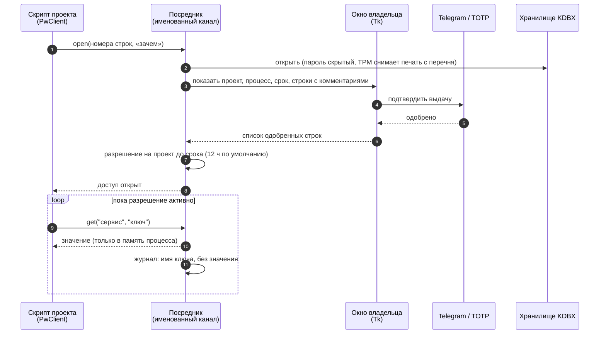
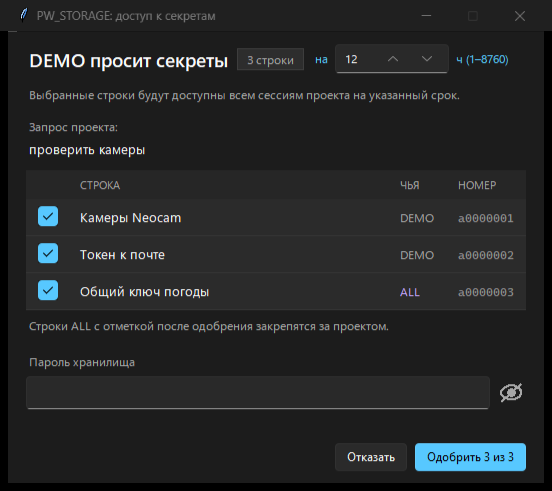
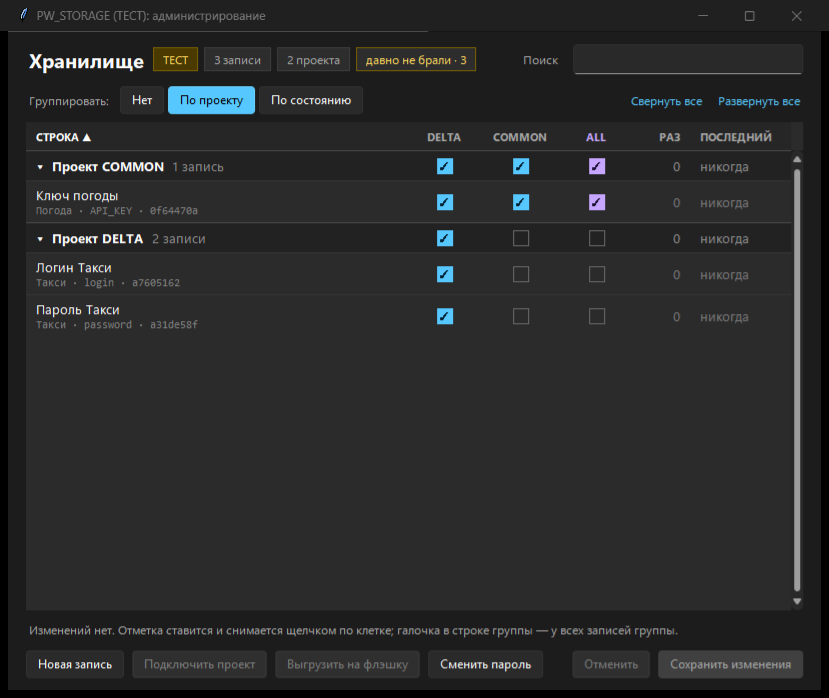
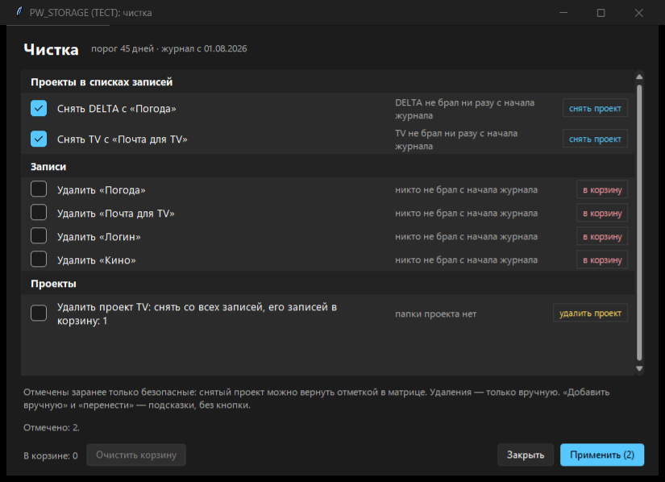
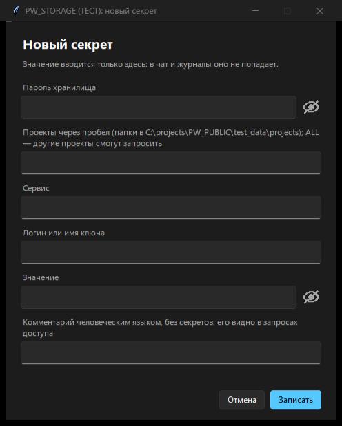
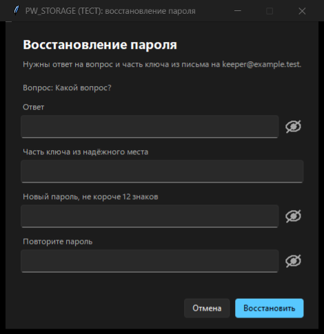

# PW_STORAGE

**Локальное хранилище секретов для множества проектов на одном ПК (Windows).**

Один зашифрованный файл KDBX 4.0 вместо `secrets.env`, `.env`, паролей в коде и копипасты из менеджера
паролей. Скрипты проектов получают значения по запросу, владелец подтверждает выдачу в окне или с телефона,
значения не попадают в файлы, git, журналы и чат ассистента.

Windows 10/11 · Python 3.11+ · TPM 2.0 · KDBX 4.0 (Argon2id) · без облака и без сервера

---

## Почему это неудобно решать иначе

Классическая картина у одного разработчика с десятками проектов:

- в каждом проекте свой `secrets.env`, и он то в git, то в истории git, то в скриншоте для чата;
- агент или скрипт «просто читает файл» и уносит значение в контекст модели, в вывод, в журнал;
- ротация токена — обход всех папок; где лежит копия — неизвестно;
- менеджер паролей для людей: вставить руками в скрипт нельзя, а экспорт «для удобства» ломает всю защиту.

PW_STORAGE меняет формулировку: секрет — не файл проекта, а строка хранилища, у которой есть список
проектов-получателей и срок действия разрешения.

## Как это работает



Компоненты:

| Что | Файл | Роль |
|---|---|---|
| Хранилище | `data/vault.kdbx` | KDBX 4.0, Argon2id 1 GiB; проекты записаны своими свойствами записи |
| Посредник | `pw_storage/broker.py` | держит открытое хранилище в памяти, раздаёт значения, пишет журнал |
| Клиент | `pw_storage/client.py` | `PwClient().get("сервис", "ключ")` в скрипте проекта |
| Команды | `pw.py` | `list`, `open`, `status`, `report`, `close` |
| Окна владельца | `pw_storage/window.py`, `manage.py`, `cleanup.py`, `projects.py`, `admin.py` | подтверждение, матрица «записи × проекты», чистки, подключение проектов, обслуживание |
| Перечень строк | `data/catalog.bin` | список «номер + комментарий», запечатанный ключом TPM: виден до ввода пароля |
| Службы без человека | `pw_storage/service_host.py`, `service_store.py` | Windows-служба получает свой пакет секретов, TPM-ключ привязан к SID службы |

Проект определяется по процессу и рабочей папке: проект — первая папка внутри `projects_root`,
сессия — ближайший предок-агент (иначе `manual`). Это защита от ошибки, а не от злого умысла:
процесс той же учётной записи технически может обратиться к посреднику.

## Что получаешь

- **Один пароль на всё хранилище**, а доступ — по строкам и по проектам, на срок от 1 часа до года.
- **Подтверждение выдачи**: окно за ПК, кнопки в Telegram, при отсутствии связи — код из приложения-аутентификатора.
- **Комментарий у каждой строки** («токен поиска», «логин кабинета оператора»): владелец видит, что именно просят,
  до ввода пароля. Строки без комментария не выдаются вообще.
- **Пометка `ALL`** — не «доступно всем», а «другой проект может запросить»; одобрение добавляет проект в список.
- **Журнал** `logs/access.log` (JSON-строки): кто, какую строку, сколько раз. Значений там нет.
- **Чистки** по журналу: неиспользуемые строки, лишние проекты в списках, забытые открытые файлы секретов.
- **Восстановление пароля** без резервной копии секрета: файл восстановления + контрольный вопрос + часть ключа
  из надёжного места. Часть ключа программа никому не отправляет.
- **Выгрузка** на флэшку: zip с AES-256, пароль — длинная фраза, носитель помечается доверенным по серийному номеру.
- **Службы и боты без тебя**: у службы свой пакет секретов, доступ к нему имеет только её учётная запись
  `NT SERVICE\<имя>`, TPM-ключ запечатан под её SID.
- **Совместимость формата**: файл читается KeePassXC 2.8.0, включая теги проектов.

## Чего здесь нет (важно)

- Не менеджер паролей для браузера и не общее хранилище на команду: один владелец, один ПК.
- Не синхронизация и не бэкап в облако — это остаётся на твоём средстве (файл KDBX можно хранить где угодно).
- Не защита от процесса, запущенного от твоей учётной записи, пока хранилище открыто, и не защита от клавиатурного
  шпиона. Модель угроз целиком — в [docs/security-model.md](docs/security-model.md).
- Только Windows: нужны TPM 2.0 (Microsoft Platform Crypto Provider) и именованные каналы.

## Быстрый старт

```bat
git clone https://github.com/xitromu/pw-storage-public.git C:\projects\PW_STORAGE
cd /d C:\projects\PW_STORAGE
install.bat
```

Дальше — демо-профиль (`test_data`, значения случайные, настоящее ничего не трогает):

```bat
pw_menu.bat --profile test      :: N — «Создать хранилище»: пароль, контрольный вопрос, код TOTP
pw_console.bat                  :: посредник демо-профиля, окно подтверждения на этом ПК
test_data\projects\DEMO_A\demo.py   :: скрипт проекта просит свои строки и пробует чужие
```

Когда захочется своих: `pw_menu.bat` (боевой профиль), окно «Новая запись», а проект подключается
командой `pw.py open` — см. [docs/integrating-a-project.md](docs/integrating-a-project.md).

## Проект в коде

```python
from pw_storage.client import NeedsAccess, NotFound, PwClient

pw = PwClient()                       # посредник поднимется сам
try:
    token = pw.get("Поиск", "API_KEY")
except NeedsAccess:
    ...                               # проекта нет в списке строки: pw.py open --why "зачем" <номера>
except NotFound:
    ...                               # такой строки нет
```

Значение приходит только в память вызывающего процесса. Ни `pw.py`, ни клиент не имеют команды, которая
печатает значение: это ограничение заложено в интерфейс.

## Интеграция с агентом

Проект подключается блоком в `CLAUDE.md` (окно «Проекты» → «Показать и записать»): там правила «не читать
файлы секретов», команда перечня и команда запроса. Текст —
[docs/integrating-a-project.md](docs/integrating-a-project.md).

## Формат и внешние инструменты

| Инструмент | Статус |
|---|---|
| KeePassXC 2.8.0 (GUI и CLI) | читает и пишет наши записи, теги проектов сохраняются |
| KeePass2 CLI | формат читает, теги проектов теряет — с PW_STORAGE не совмещать |
| WinRAR / 7-Zip | открывают архив выгрузки (zip, AES-256) |

## Скриншоты

| Окно доступа: что просят | Окно доступа: подтверждение |
|---|---|
|  |  |

| Матрица «записи × проекты» | Одна запись |
|---|---|
|  |  |

| Чистки | Проекты |
|---|---|
|  |  |

| Новая запись | Восстановление пароля |
|---|---|
|  |  |

| Первое создание хранилища | Выгрузка на флэшку |
|---|---|
|  |  |

Все снимки собраны из демонстрационных данных (`tools/make_screenshots.py`); настоящие имена проектов
и значений на них нет.

## Документация

| Раздел | О чём |
|---|---|
| [docs/install.md](docs/install.md) | проверка версий, установка, первый запуск, настройки `data/settings.json` |
| [docs/architecture.md](docs/architecture.md) | компоненты, файлы, протокол канала, каталог и TPM, службы |
| [docs/security-model.md](docs/security-model.md) | от чего защищает, от чего нет, матрица угроз |
| [docs/operations.md](docs/operations.md) | выдача и отзыв, восстановление, выгрузка, чистки, режимы владельца |
| [docs/protocol.md](docs/protocol.md) | сообщения канала: операции, поля, ответы, коды ошибок |
| [docs/integrating-a-project.md](docs/integrating-a-project.md) | как перевести проект с файлов секретов |
| [SECURITY.md](SECURITY.md) | как сообщить о проблеме и что делать при утечке |

## Тесты

```bat
set PW_STORAGE_REAL_TPM=0
set PYTHONUTF8=1
.venv\Scripts\python.exe -m unittest discover -s tests -t .
```

793 теста на синтетических данных (временные папки, фейковый TPM), 3 пропуска без KeePassXC и настоящего TPM.
Аппаратные проверки: `set PW_STORAGE_REAL_TPM=1` — создают и удаляют только ключи `PW_STORAGE_TEST_*`.

## Лицензия и ответственность

MIT — см. [LICENSE](LICENSE). Программа ведёт себя так, как описано в документации, и не гарантирует
сохранность твоих данных: резервные копии, стойкий пароль и здравый смысл остаются на твоей стороне.
Если что-то пошло не так — [docs/operations.md](docs/operations.md) описывает восстановление и отзыв доступа.

---

## English (summary)

**PW_STORAGE is a local secrets vault for many projects on one Windows PC.** Values live in a single
KDBX 4.0 file (Argon2id, 1 GiB memory), not in per-project `secrets.env`. A broker process holds the opened
vault in memory and answers requests over a Windows named pipe; the project is derived from the calling
process and its working folder, and the owner approves each issuance — in a window, via Telegram inline
buttons, or with a TOTP code when there is no connectivity.

Grant model: one vault password, permissions are per record and per project, valid for a configurable
period (12 hours by default, 1–8760 hours). Every record carries a human-readable comment, and the owner
sees exactly which rows a request needs before unlocking; rows without a comment are never issued. `ALL`
does not mean "public" — it means "another project may ask", and approval adds that project to the list.

Values never reach stdout, logs, chat or git: neither `pw.py` nor the client has a command that prints a
secret. The audit journal records which project took which key, and the cleanup window turns that
statistics into housekeeping suggestions. Recovery of a forgotten password uses a recovery file plus a
control question plus a key part you keep somewhere safe — the program never sends it anywhere. Export
writes an AES-256 zip to a volume you marked trusted by its serial number. Windows services run without
you: each gets its own secret package under `ProgramData`, sealed by a TPM key bound to the service SID,
so only `NT SERVICE\<name>` can read it.

Requires Windows 10/11 with TPM 2.0 and Python 3.11+. No cloud, no server, no telemetry. The file format
stays readable by KeePassXC 2.8.0 (project tags included). It is not a team vault, not a browser password
manager, and it does not protect against a process running as you while the vault is open — see
[docs/security-model.md](docs/security-model.md) (Russian) for the full threat model. MIT licensed.
