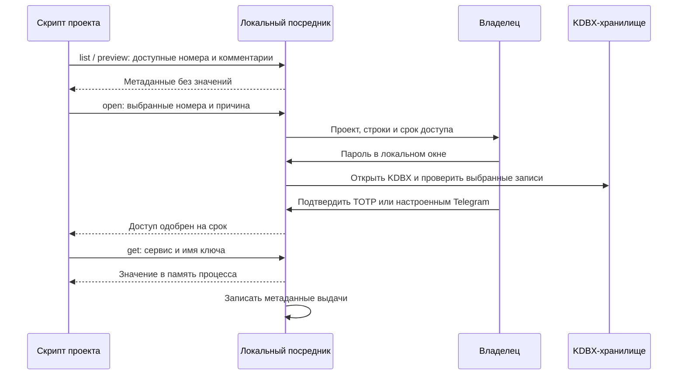
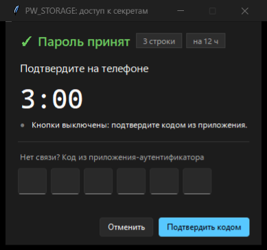
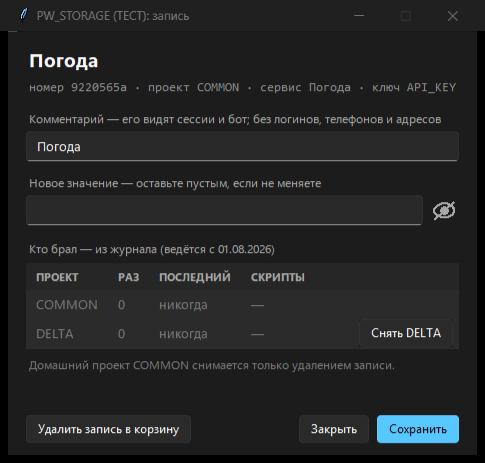
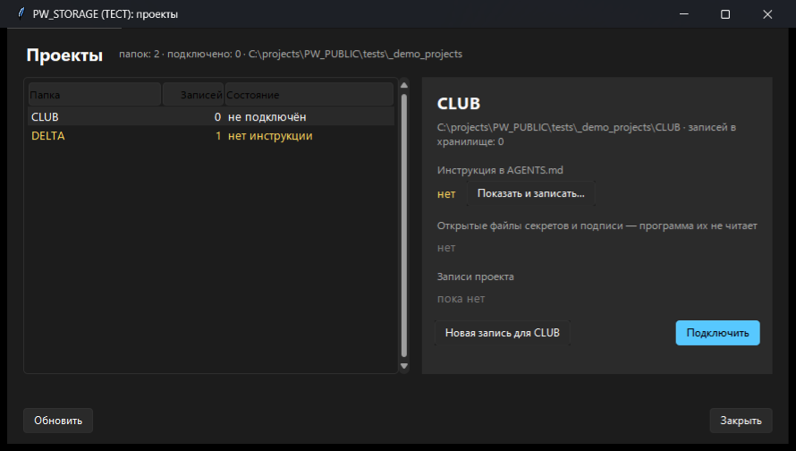
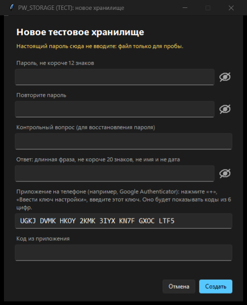
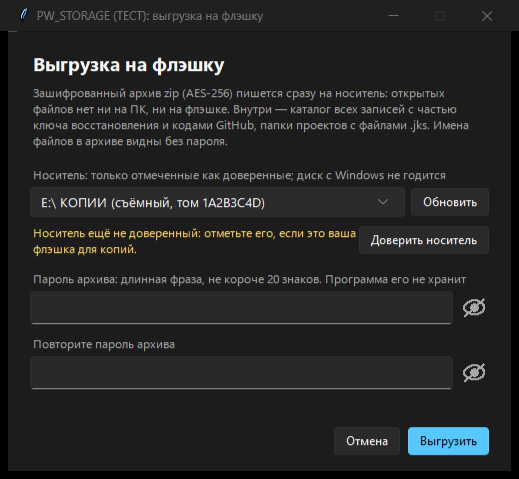

# PW_STORAGE — хранилище секретов для Windows-проектов

**Local-first secrets management for Windows, Python scripts and AI-assisted development.**

Один зашифрованный файл вместо копий API-ключей в десятках `.env`. Владелец выбирает записи и срок доступа,
а скрипты получают одобренные значения через Python-клиент. Для этого не требуется облачное хранилище или
отдельный сервер: посредник работает на твоём Windows-ПК.

**Windows 10/11 x64 · Python 3.11+ · TPM 2.0 · KDBX 4 / Argon2id · MIT**

[Зачем это нужно](#зачем-это-нужно) · [Что уже готово](#что-уже-готово-вместо-разработки-с-нуля) ·
[Попробовать](#быстрый-старт-без-настоящих-секретов) · [Подключить проект](#как-подключить-свой-проект) ·
[Потенциал](#потенциал-развития-сервер-облако-и-команда) · [Границы защиты](#границы-защиты) · [English](#english)


## Зачем это нужно

Когда у тебя несколько скриптов, ботов и проектов с AI-ассистентом, проблема не только в шифровании:
**где хранится каждый ключ, кому он нужен, кто его уже получил и когда закончится доступ?**

Файлы `.env` просты и полезны, но требуют дисциплины: копии могут попасть в git, резервные папки,
вывод отладки или контекст ассистента. PW_STORAGE предлагает другой рабочий процесс:

1. Секрет вводит владелец в окно хранилища, а не в чат и не в файл проекта.
2. Проект видит номера записей и понятные комментарии; запрашивает только нужные записи с объяснением.
3. Владелец одобряет выбор и срок. Чтение доступно всем сессиям этого проекта до истечения срока.
4. Скрипт получает значение в память через `PwClient().get(...)`; посредник записывает метаданные выдачи.

Это снижает необходимость копировать значения и упрощает обслуживание множества проектов.
**Но получивший секрет скрипт всё ещё может его вывести или сохранить:** PW_STORAGE не является песочницей.

### Кому подходит

- Разработчику на Windows, у которого несколько проектов с API-ключами и паролями сервисов.
- Автору Python-скриптов и локальной автоматизации, которому нужен единый способ получения секретов.
- Пользователю AI-ассистента, который хочет давать агенту команды и метаданные, а не значения ключей.
- Автору Windows-службы или бота: для постоянного процесса есть отдельные TPM-пакеты секретов.

Для командного облачного хранилища, браузерного автозаполнения или Linux/macOS выбери другое решение.

## Что уже готово вместо разработки с нуля

Это не только обёртка над шифрованием. В репозитории собраны хранение, выдача, обслуживание и интеграция:

| Уже реализовано | Практическая польза |
|---|---|
| KDBX 4, Argon2id, Python-клиент и посредник | Не нужно отдельно связывать базу, IPC и загрузку секретов в скриптах |
| Матрица «записи × проекты», одобрение выбранных строк | Одно значение можно использовать в нескольких проектах без отдельных `.env`-копий |
| Доступ на 1–8760 часов, по умолчанию 12; команда `close` | Не нужно повторять подтверждение для каждого запуска; можно прекратить новые чтения проекта |
| `ALL` означает «можно запросить», а не «доступно всем» | Общий ключ остаётся под контролем владельца, а не выдаётся автоматически |
| TOTP; необязательные кнопки в Telegram | Есть локальный путь без Telegram и подтверждение с телефона при настроенном боте |
| Журнал метаданных и окно чистки | Видно, какие записи выдавались проектам; проще найти неиспользуемые права и записи |
| Восстановление пароля и зашифрованная выгрузка | Есть предусмотренные процедуры, а не необходимость придумывать их после потери доступа |
| TPM-пакеты под SID Windows-служб и надзор за процессом | Есть отдельный путь для постоянно работающих процессов без интерактивного окна |
| Демо, 10 снимков окон, документация и тесты | Можно сначала проверить рабочий процесс на синтетических данных и изучить реализацию |

Репозиторий можно использовать **как готовый локальный инструмент**, **как основу интеграции своих проектов**
или **как изучаемый пример архитектуры**. MIT разрешает использовать и изменять код, в том числе коммерчески,
с сохранением уведомления о лицензии. Интеграцию со своими API всё равно потребуется написать;
ответственность за безопасность своего окружения остаётся у тебя.

### Чем отличается от других подходов

| Подход | Когда удобен | Что добавляет PW_STORAGE |
|---|---|---|
| `.env` / переменные окружения | Простая настройка приложения и существующие схемы развёртывания | Централизованные записи, одобрение выдачи, сроки и журнал; меньше копий в папках проектов |
| KeePassXC | Хранение и ручная работа с паролями | Проектный Python API и управляемая выдача поверх совместимого KDBX-формата |
| Облачный менеджер секретов | Команды, несколько машин, централизованные политики | Локальный путь без обязательного облачного аккаунта; не замена командной инфраструктуре |
| Собственная реализация | Нестандартные требования и полный контроль | Уже собранный рабочий процесс, процедуры обслуживания и проверяемый исходный код |

## Потенциал развития: сервер, облако и команда

Разделение на клиент, посредник и хранилище даёт отправную точку для дальнейшего развития:

- **Серверная версия:** несколько компьютеров запрашивают секреты у отдельного сервиса.
- **Облачная версия:** размещение такого сервиса в собственном или управляемом облаке.
- **Командная версия:** несколько пользователей, роли, общие проекты и согласование доступа.

**В этой версии ничего из перечисленного не реализовано.** Сейчас канал локальный и Windows-специфичный,
идентичность определяется процессом и папкой, а TPM-пакеты привязаны к машине и SID службы.
Для сетевой версии потребуются аутентификация пользователей и клиентов, защищённый транспорт,
серверное управление ключами, разграничение доступа, резервирование и новая модель угроз.
Для команды — ещё роли, отзыв доступа пользователей и совместное администрирование.

Можно переиспользовать идеи выдачи отдельных записей, срока доступа, подтверждений и журнала,
но это отдельная разработка и проверка безопасности, **не настройка, включающая облачный режим**.
Сейчас репозиторий полезен как локальный инструмент и как основа для изучения и дальнейших расширений.

## Быстрый старт без настоящих секретов

**Нужно:** Windows 10/11 x64, Python 3.11+ с Tk, TPM 2.0 и приложение-аутентификатор с TOTP.
Git нужен только для клонирования; альтернативно скачай **Code → Download ZIP** на GitHub.
KeePassXC, Telegram и права администратора для первого демо не нужны.

Команды ниже — для **командной строки Windows (`cmd.exe`)**, не для PowerShell или Git Bash.
Выбери новую папку: не устанавливай поверх существующего хранилища.

```bat
git clone https://github.com/xitromu/pw-storage-public.git C:\projects\pw-storage-public
cd /d C:\projects\pw-storage-public
install.bat
pw_menu.bat --profile test
```

1. В меню выбери **`N` — «Создать хранилище»**. Используй отдельный тестовый пароль от 12 знаков.
2. Заполни контрольный вопрос и ответ от 20 знаков. Добавь показанный ключ в приложение-аутентификатор
   и введи его текущий шестизначный код. Сохрани показанную после создания часть ключа восстановления.
3. Закрой окно создания, нажми Enter для возврата в меню и **`0` для выхода**.
4. В той же командной строке запусти демо:

```bat
.venv\Scripts\python.exe -X utf8 test_data\projects\DEMO_A\demo.py
```

Демо само запускает посредника через `preview` / `open`. В окне выбери записи, введи тестовый пароль
и подтверди TOTP-кодом. Telegram в тестовом профиле выключен по умолчанию.

**Что должно произойти:** скрипт показывает метаданные своих и общих записей, получает одобренные значения
без их печати, демонстрирует отказ для чужой записи и показывает отчёт. Повторный запуск при действующем
доступе не требует нового одобрения уже выданных строк. Закрой окно посредника, чтобы закончить пробу.

Данные демо находятся в `test_data/`, значения генерируются с префиксом `TEST-`.
Основной профиль `data/` не используется. Демо не обращается к внешним сервисам за полученные ключи,
но создаёт свои файлы и TPM-ключи на этом ПК.

Если не получается: [пошаговая установка](docs/install.md) и [диагностика](docs/operations.md#диагностика).
Полный прогон тестов необязателен для первого знакомства.

## Как подключить свой проект

Пример: проект `C:\projects\REPORT`, запись с сервисом `Погода` и ключом `API_KEY`.

1. Запусти `pw_menu.bat` **без `--profile test`** и создай основное хранилище (пункт `N`).
2. Добавь запись (пункт `2`): проект `REPORT`, сервис `Погода`, ключ `API_KEY`, понятный комментарий.
   Реальное значение вводи только в окно. Не используй тестовый пароль для основного хранилища.
3. Из папки проекта посмотри доступные номера и запроси нужный:

```bat
cd /d C:\projects\REPORT
C:\projects\pw-storage-public\.venv\Scripts\python.exe C:\projects\pw-storage-public\pw.py list
C:\projects\pw-storage-public\.venv\Scripts\python.exe C:\projects\pw-storage-public\pw.py open --why "Получить данные погоды для отчёта" 1a2b3c4d
```

**Замени `1a2b3c4d` номером своей записи из `list`.** Подтверди запрос в окне.
Затем в скрипте проекта:

```python
import sys

sys.path.insert(0, r"C:\projects\pw-storage-public")
from pw_storage.client import BrokerUnavailable, NeedsAccess, NotFound, PwClient

try:
    token = PwClient().get("Погода", "API_KEY")
except (BrokerUnavailable, NeedsAccess, NotFound) as error:
    raise SystemExit(f"Нужен доступ к записи: {error}") from None
```

Используй `token` в клиенте своего сервиса, **не печатай его и не передавай в аргументах команд**.
Клиент работает со стандартной библиотекой Python; зависимости хранилища остаются в его `.venv`.
Сам `get()` не запускает посредник и не запрашивает разрешение: это делают `list` / `preview` и `open`.

`pw.py status` показывает срок, `pw.py report` — полученные записи, `pw.py close` прекращает новые чтения
**всего проекта**, а не только одного скрипта. Уже полученные значения из памяти других процессов не исчезнут.

[Полная интеграция и перенос с файлов секретов](docs/integrating-a-project.md) ·
[Службы и боты без человека](docs/operations.md#службы-без-человека)

### Работа с AI-ассистентом

Окно «Проекты» может записать правила в `AGENTS.md`: агент видит команды запроса и метаданные,
а значение получает выполняемый скрипт. Подключи этот файл к инструкциям своего ассистента:
не все инструменты читают `AGENTS.md` автоматически. Распознавание сессии не означает загрузку правил;
идентификатор сессии может оставаться `manual` и не мешает работе проектных разрешений.

Это инструкция, **не принудительная изоляция агента**: не разрешай ему читать базу, резервные копии,
печатать полученные ключи или запускать недоверенный код с твоими правами.

## Как это работает



Проект определяется по пути скрипта и рабочей папке, а не по переданному клиентом названию.
По умолчанию корень — `C:\projects`; другой можно задать в настройках.
KDBX шифруется паролем, а TPM защищает отдельные каталог, удалённый код и пакеты служб:
**сам файл KDBX не привязан к TPM и переносится при наличии пароля**.

Основные точки входа: `pw.py` — команды; `pw_storage/client.py` — клиент;
`broker.py` — выдача и сроки; `vault.py` — KDBX; `service_store.py` / `service_host.py` — службы.
[Архитектура](docs/architecture.md) · [Протокол](docs/protocol.md)

## Границы защиты

- Это инструмент для **одного владельца на одном Windows-ПК**, не командное хранилище и не песочница.
  Код той же учётной записи, администратор или вредонос могут обойти проектные договорённости и читать память.
- Клиент и посредник штатно не печатают значения. Но код-получатель может раскрыть их;
  `.gitignore` не удаляет прежние утечки из истории и не запрещает принудительное добавление файлов.
- Каталог показывает комментарии без пароля внутри разрешённого корня проектов. В журнале есть проекты,
  пути и причины запросов. **Метаданные тоже могут быть чувствительными** — не вписывай туда секреты.
- Основной путь **пароль + TOTP работает без Telegram**. Если включить Telegram, туда уходят метаданные
  запроса; при удалённом входе через бота — также отдельный код доступа. Обычное подтверждение кнопкой
  не требует отправлять пароль KDBX в чат.
- Удаление прав через другое окно или внешний редактор не гарантирует немедленный отзыв в уже работающем
  посреднике: для немедленного прекращения новых чтений используй `close` из проекта или останови посредника.
  Отзыв пакета службы также не стирает значения, которые процесс успел получить.
- Восстановление требует `recovery.json`, ответа и отдельно сохранённой части ключа.
  Копия KDBX не помогает при забытом пароле без данных восстановления; выгрузка восстанавливается вручную,
  автоматического импорта архива нет.
- Тесты не заменяют независимый аудит безопасности. Здесь не заявляется сертификация или защита от всех утечек.

[Полная модель угроз](docs/security-model.md) · [Сообщить об уязвимости](SECURITY.md)

## KeePassXC и комплект установки

`install.bat` создаёт `.venv` и устанавливает зафиксированные Python-зависимости с проверкой хешей.
В комплекте — исходный код, окна владельца, клиент, демо-генератор, примеры конфигураций служб и документация.
Настоящие хранилища, ключи и сторонние установщики в репозиторий не включены.

**KeePassXC необязателен для работы приложения.** Совместимость проверялась с KeePassXC 2.8.0:
он позволяет работать с KDBX отдельно от PW_STORAGE. Перед внешним редактированием останови посредник
и сделай резервную копию. У других редакторов сохранение проектных свойств не гарантируется;
для проверенного KeePass2 CLI обнаружена потеря тегов.

Экспорт — ZIP с AES-256, а не копия KDBX; его каталог читается после распаковки текстовым редактором.
Для открытия подходят инструменты с поддержкой AES-ZIP, например 7-Zip или WinRAR.

## Скриншоты

Все снимки получены из синтетических данных; реальные имена проектов и значения не публикуются.
Полную матрицу доступа смотри в начале страницы.

| Запрос доступа | Подтверждение |
|---|---|
|  |  |

| Запись | Проекты |
|---|---|
|  |  |

<details>
<summary>Ещё пять окон: создание, новая запись, восстановление, выгрузка и чистки</summary>

| Создание хранилища | Новая запись |
|---|---|
|  |  |

| Восстановление | Выгрузка |
|---|---|
|  |  |


</details>

## Документация

| Раздел | Что найдёшь |
|---|---|
| [Установка](docs/install.md) | требования, первый запуск, настройки и обновление |
| [Интеграция проекта](docs/integrating-a-project.md) | клиент, команды, переход с `.env`, правила для агента |
| [Эксплуатация](docs/operations.md) | выдача и отзыв, восстановление, выгрузка, службы, диагностика |
| [Архитектура](docs/architecture.md) | компоненты, хранение, TPM и границы процессов |
| [Протокол](docs/protocol.md) | операции канала, поля и ошибки |
| [Модель угроз](docs/security-model.md) | защиты, ограничения и параметры криптографии |
| [Безопасность](SECURITY.md) | сообщения об уязвимостях и действия при утечке |

## Проверка и участие

Последний проверенный исходный снапшот: **793 теста, 3 пропуска** на синтетических данных.
Пропуски относятся к проверкам с настоящим TPM и KeePassXC. Это результат конкретного запуска,
а не обещание прохождения на любой машине; базовое демо использует настоящий TPM.

Полный прогон по желанию:

```bat
set PW_STORAGE_REAL_TPM=0
set PYTHONUTF8=1
.venv\Scripts\python.exe -m unittest discover -s tests -t .
```

Для разработки запускай сначала нужный модуль, например `python -m unittest tests.test_pw` из `.venv`.
Аппаратные тесты включаются отдельно через `PW_STORAGE_REAL_TPM=1` и создают тестовые ключи.

**Как помочь:** сообщи об ошибке установки или непонятном шаге через Issues; предложи улучшение документации,
совместимости или тестов через Pull Request. Укажи Windows/Python, коммит, профиль и шаги воспроизведения.
Используй только синтетические данные. Не прикладывай KDBX, recovery-файлы, пакеты служб или реальные журналы.
Уязвимости сообщай приватно по [SECURITY.md](SECURITY.md), а не в публичном Issue.

## English

### Local secrets management without per-project copies

**PW_STORAGE is a local secrets vault and approval broker for multiple projects on one Windows PC.**
Keep API keys and service passwords in a single KDBX 4 file instead of copying them into every `.env`.
Projects request records by ID and purpose; the owner approves selected records for a limited time.
Python scripts receive approved values through `PwClient`, without a CLI command that prints secrets.

Useful for Windows developers, Python automation and AI-assisted development. A separate path supports
long-running Windows services using TPM-protected packages bound to each service SID.
No cloud vault account or dedicated server is required. Telegram is optional; local password + TOTP works without it.

### Why use this repository instead of starting from scratch?

The repository already combines KDBX/Argon2id storage, named-pipe IPC, per-project grants, owner dialogs,
TOTP and optional Telegram confirmations, audit metadata, cleanup, password recovery, encrypted export,
service supervision, sample configuration, demo scripts and tests. You can use it locally, integrate it into
existing scripts, or study and adapt the architecture under the MIT license.

It is not a generic encryption snippet, but you still need to integrate your own service clients and
review the code and threat model for your environment. KeePassXC is an optional compatible KDBX editor,
not a required runtime dependency. Exported ZIP archives are restored manually, not imported automatically.

### Future potential — not implemented

The client/broker/storage separation offers a starting point for a server edition, a cloud-hosted service
or team access with multiple users and roles. **None of these are implemented in this release.**
The current IPC, process identity and TPM/service bindings are Windows-local. A remote edition would need
authentication, a secure network protocol, server-side key management, authorization, backup/recovery and
a new threat model; a team edition would also need roles and shared administration.
The approval, grant and audit concepts can be reused, but this is new engineering, not an existing cloud switch.

### Try the demo

Requires **Windows 10/11 x64, Python 3.11+ with Tk, TPM 2.0 and a TOTP authenticator**.
The interface and detailed guides are currently in Russian. Run in **Windows Command Prompt**:

```bat
git clone https://github.com/xitromu/pw-storage-public.git C:\projects\pw-storage-public
cd /d C:\projects\pw-storage-public
install.bat
pw_menu.bat --profile test
```

Choose `N`, set a test password, recovery question/answer and enroll the displayed TOTP key.
Enter the current authenticator code. Save the recovery key part, close the dialog, press Enter and choose `0`.
Then run:

```bat
.venv\Scripts\python.exe -X utf8 test_data\projects\DEMO_A\demo.py
```

The demo starts the broker, asks for approval and shows metadata, successful reads and a refused foreign
record without printing secret values. It creates demo files and TPM keys; it does not use your main vault
or call external services with the generated credentials. Telegram is disabled in the test profile by default.

### Integrate and understand the limits

Create a main vault, assign a record to your project, then run `pw.py list` and `pw.py open` from the project
folder. Use `PwClient().get(service, key)` only after approval. `get()` itself does not start the broker.
See the [Python integration guide](docs/integrating-a-project.md) and [service setup](docs/operations.md#службы-без-человека).

This is **not a sandbox or a team vault**. Same-user malicious code can bypass project conventions or read memory;
a receiving script can still leak a value. Grants control new reads, not copies already obtained.
Changes made outside the broker may require `close` or a broker restart to revoke an existing in-memory grant.
Logs/catalogs contain potentially sensitive metadata; Telegram receives request metadata and, for remote login,
a separate access code. Tests are not a substitute for an independent security audit.

[Threat model](docs/security-model.md) · [Installation](docs/install.md) · [Security reporting](SECURITY.md)

## Лицензия

[MIT](LICENSE). Код предоставляется без гарантий. Используй стойкие пароли, проверяй резервные копии
и начинай с демо, прежде чем доверять приложению реальные секреты.
