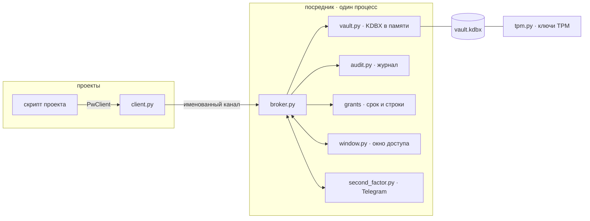

# Архитектура

Система состоит из одного долгоживущего процесса-посредника и нескольких тонких клиентов.
Файл хранилища расшифрован только в памяти посредника; все остальные процессы получают по одному
значению по локальному каналу.

## Компоненты

| Модуль | Роль |
|---|---|
| `pw.py` | команды проекта: `list`, `open`, `status`, `report`, `close`. Значений не печатает и печатать не будет |
| `pw_storage/client.py` | библиотека для скриптов: `get`, `get_attachment`, `save_token`, `rows`. Только стандартная библиотека, подходит любой Python 3.10+ |
| `pw_storage/broker.py` | посредник: держит открытую базу в памяти, проверяет доступы, заводит окно, ведёт журнал, закрывается без дела |
| `pw_storage/vault.py` | файл KDBX 4 поверх pykeepass: запись = проект(ы), пометка `ALL`, сервис, имя ключа, значение, комментарий |
| `pw_storage/procinfo.py` | кто обратился: проект и сессия по процессу на другом конце канала, а не со слов скрипта |
| `pw_storage/catalog.py` | перечень строк для окна до ввода пароля; зашифрован ключом TPM |
| `pw_storage/tpm.py` | ключи TPM 2.0 через `ncrypt.dll` (Microsoft Platform Crypto Provider) |
| `pw_storage/window.py` | окно доступа: пароль, матрица строк, причина запроса |
| `pw_storage/second_factor.py` | подтверждение с телефона кнопками в своём Telegram-боте; при отсутствии сети — TOTP |
| `pw_storage/remote.py` | доступ без ПК: отдельный код с приставкой `pw` вместо пароля хранилища |
| `pw_storage/recovery.py` | файл восстановления: пароль под ключом из ответа на вопрос и отдельно хранимой части |
| `pw_storage/export.py` | выгрузка на доверенный носитель: zip AES-256 собирается в памяти |
| `pw_storage/manage.py` | окно администрирования: матрица «записи × проекты» |
| `pw_storage/cleanup.py` | чистки: давно не бранные строки, строки без комментария, кто и что брал |
| `pw_storage/projects.py` | подключение проекта: блок-инструкция в `CLAUDE.md` |
| `pw_storage/admin.py` | обслуживание: создание хранилища, смена пароля, выдача секретов службам |
| `pw_storage/service_host.py` | служба Windows: SCM-слой и надзор за детским процессом |
| `pw_storage/service_store.py` | отдельные пакеты секретов для виртуальных учётных записей служб |
| `pw_storage/audit.py` | журнал выдачи: время, событие, проект, сервис, имя ключа. Значений здесь нет |
| `tools/owner_menu.py` | меню владельца (запуск `pw_menu.bat`) |

## Идентичность проекта

Посредник не верит названию проекта в запросе. По pid на другом конце канала (`procinfo.py`) строится
цепочка родительских процессов и ищется:

- **сессия** — ближайший предок `claude.exe` (иначе `manual`);
- **проект** — первая папка под `projects_root`: сначала по пути запускаемого скрипта, затем по рабочей папке.

Поэтому запускать проектные команды нужно из папки проекта, а скрипт не может выдать себя за другой проект,
не будучи физически в нём размещён. `projects_root` по умолчанию `C:\projects`, меняется в
`data/settings.json` (см. [install.md](install.md#настройки-профиля)).

## Доступы

Доступ выдаётся на проект, а не на сессию: все процессы одного проекта видят одобренные строки, пока не
истечёт срок или пока проект не закроют (`pw.py close`). Срок — `grant_hours` (по умолчанию 12 ч, 1…8760).

- Одобряются конкретные строки; `ALL` — строка, доступная для запроса другим проектам.
- `_SYSTEM` — служебные записи (TOTP, часть ключа восстановления): в перечень и проектам не попадают.
- Строки без комментария не выдаются: по ним нельзя понять, что просят.
- Значение выдаётся только если строка не менялась после подтверждения (сверка по «штампу» записи).
- После истечения срока или `close` посредник забывает одобренные строки; значения в памяти остаются только
  у того процесса, который их получил.

## Хранилище

KDBX 4.0, KDF Argon2id (память 1024 МиБ, проходы 4, параллелизм 4). Проекты хранятся в пользовательских
полях записей и в названиях групп, поэтому файл открывается в KeePassXC 2.8.0: удобно править структуру,
когда посредник остановлен. **KeePass2 CLI (`keepassxc-cli`/`kpcli`) не подходит** — при сохранении теряются
пользовательские поля, то есть метки проектов. Права на файл: только текущий пользователь и `SYSTEM`.

Файл перезаписывается атомарно через временную копию; незавершённая запись восстанавливается
(`Vault.resume`) и при сомнении блокирует выдачу до разбора владельцем.

## Файлы

| Путь | Что лежит |
|---|---|
| `data/vault.kdbx` | хранилище (KDBX 4, Argon2id) |
| `data/vault.kdbx.transaction` | журнал незавершённой записи: появляется на время сохранения и говорит, что разбор нужен |
| `data/vault.kdbx.bak` | предыдущая версия файла (после ротации recovery) |
| `data/recovery.json` | файл восстановления: пароль под ключом из ответа и отдельно хранимой части |
| `data/catalog.bin` | перечень строк для окна до пароля, зашифрован ключом TPM |
| `data/remote.bin` | пароль, запечатанный кодом доступа через бота |
| `data/settings.json` | настройки профиля: `projects_root`, `grant_hours`, `telegram`, `recovery_mail`, … |
| `logs/access.log` | журнал выдачи (без значений) |
| `test_data/` | то же самое для тестового профиля |
| `%PROGRAMDATA%\PW_STORAGE_SERVICE_<profile>_<NAME>` | пакеты секретов служб |
| `%PROGRAMDATA%\PW_STORAGE_LOGS\<NAME>` | журналы служб |

В репозиторий ничего из этого не попадает: `data/`, `test_data/`, `logs/`, `*.kdbx`, `*.bin`,
`recovery.json`, `settings.json` и конфигурации служб исключены `.gitignore` — рядом лежат только примеры
(`settings.example.json`, `deploy/services/*.example.json`).

## Перечень и TPM

Окно доступа должно показывать строки до ввода пароля, иначе владелец не может одобрить то, чего не видит.
Для этого посредник держит `catalog.bin` — перечень номеров, комментариев и меток проектов, зашифрованный
ключом TPM этого ПК. Закрытая часть не извлекается: файл с чужого компьютера не читается, а перехват
переписки или копии диска даёт только беспорядочные байты.

Каталог пересобирается при каждом изменении хранилища. В нём лежит SHA-256 файла, для которого он собран:
если хранилище менялось позже, посредник помечает перечень устаревшим (`stale`), а если каталога нет, он
битый или выпущен для другого файла (например, перенесён с другого ПК) — отсутствующим (`missing`). Тогда
первые строки владелец собирает паролем.

## Канал

Один именованный канал Windows на профиль: `\\.\pipe\pw_storage` (тестовый — `\\.\pipe\pw_storage_test`).
Формат — одно JSON-сообщение на соединение, ответ в том же соединении. Отдельного секрета у канала нет:
доступ к нему ограничивает Windows (пользователь, от имени которого работает посредник), а кто именно
обратился — определяет процесс на другом конце. Описание сообщений, полей и кодов ошибок —
в [protocol.md](protocol.md).

Запросы `open` обрабатываются по одному: посредник держит в окне только текущий запрос, остальные ждут в
очереди, поэтому два проекта не могут перепутать окна. Очередь подтверждений Telegram арендуется
(`telegram_queue_lock` — файл-запрет для случая, когда тот же бот опрашивается ещё где-то): владелец lease
продлевается, а потерявший его запрос завершается ошибкой, а не молча. Посредник без подтверждений и без
запросов закрывается сам (`IDLE_EXIT_SECONDS` = 600 с), и файл уходит из памяти.

## Telegram-подтверждения

Если включены (`settings.json → "telegram": true`; для профиля `main` включено по умолчанию), посредник
поднимает поллер своего бота и присылает сообщение с кнопками. Токен и chat id берутся из самого
хранилища — строки `TG_BOT_TOKEN` и `TG_CHAT_ID` с меткой проекта `COMMON`, поэтому секретов на диске нет.
Кнопки живут `CONFIRM_SECONDS` = 180 с, потом решение принимается в окне. Опрос без `offset`: очередь только
просматривается, прочитанное не исчезает, но два поллера одного бота недопустимы.

Подтверждение с телефона не заменяет пароль: оно подтверждает выбор строк, а вход в хранилище по-прежнему
требует пароль (или удалённый код).

## Службы без человека

Постоянные скрипты (боты, планировщики) не могут дождаться владельца, поэтому у них другой путь:

1. Владелец заводит в хранилище строки службы и даёт им пометку `ALL`.
2. `service_store provision <имя>.json --apply` собирает пакет секретов службы — каталог
   `%PROGRAMDATA%\PW_STORAGE_SERVICE_<profile>_<NAME>` с файлом `credentials.bin`, зашифрованным машинным
   ключом TPM, привязанным к SID `NT SERVICE\<NAME>`, и ACL «только эта учётная запись».
3. `service_host install --name <NAME> --config <имя>.launch.json --apply` регистрирует службу Windows. Её
   процесс — базовый интерпретатор Python (не трамплин `.venv`: SCM отвергает перерождение процесса), он
   надзирает за детским процессом: перезапуск с удвоенной паузой (старт 5 с, потолок минуты, после восьми
   подряд отказов служба останавливается), логи — в `%PROGRAMDATA%\PW_STORAGE_LOGS\<NAME>\`.
4. Скрипт службы читает значения через `ServiceClient("<NAME>").get("<alias>")`; чужой пакет не читается ни
   ACL-ом, ни ключом TPM, а после `revoke` вместо значений — пустой список и флаг «разрешение отозвано».

Смена значений в хранилище в службу сама не попадает: нужен перевыпуск пакета и перезапуск (пункт 8 меню
владельца). Из-за закрытых ACL у `uv`-ссылок в виртуальном окружении службе отдельно дают право чтения кода
(`grant_service_read.bat`). Подробности и команды — в [operations.md](operations.md#службы-без-человека).

## Тестовый профиль

`--profile test` — изолированное хранилище в `test_data/`, отдельный канал, отдельный корень проектов и
свои ключи TPM; значение помечаются префиксом `TEST-`. Все 793 тестов работают на нём, поэтому боевое
хранилище при проверках не открывается.

## Пометки в коде

В докстрингах встречаются пометки вида `(Т11)`, `(Т26)` — это номера требований внутренней постановки, из
которой рос проект. На поведение они не влияют: смысл всегда описан словами рядом.
